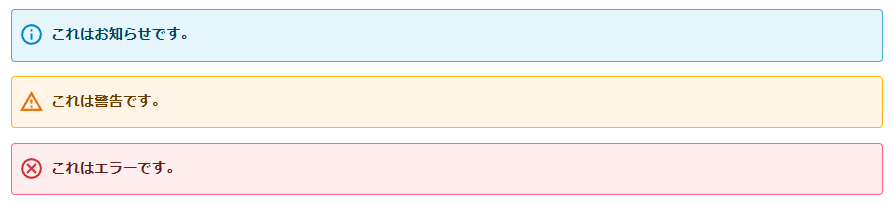

## v4.09

- **閲覧画面**: コメントのスパム対策を追加（仕様は`docs/コメントのスパム対策.md`）
  - フォームのトークンを、時刻つきの署名に変えた。フォームを出してから3秒より早いもの、24時間より古いものをはじく
  - おとりの欄、拒否するIPアドレス、同じIPアドレスからの連投をはじく
  - 名前と本文の長さの決まりと、登録ユーザーの名前と同じ名前や、管理者と紛らわしい名前（管理人、adminなど）を使えない決まりを追加。どれも、記事のページのフォームに理由を出し、書いた内容を残す
  - URL、NGワードを含むもの、日本語を含まないものを承認待ちにする
  - ブログの設定（詳細/コメント設定）に、スパム対策の項目を追加
  - 投稿ボタンを、キーを10回押すか10秒たつまで押せないようにする仕組みは残し、記事を編集できる人（ブログ管理者と編集者）だけは待たせないようにした
  - コメントのURL欄のリンクに`rel="nofollow ugc noopener noreferrer"`を付けた
- **閲覧画面**: `?_theme=`のクエリでテーマを切り替えられるのを、ブログの管理者だけにした（デザイン編集のテーマのプレビュー用）
- **編集画面**: 更新履歴を残す間隔の単位を、時間から分にした
  - システムアップデートで、今の設定値を分に変える
- **その他**: ImageMagickで画像を読み込む前に、ファイルの中身の形式を確かめるようにした
  - 拡張子が`.png`などでも中身がSVGやMVG、PostScriptなどのファイルを、その形式として処理していた
  - 扱う形式は、JPEG、PNG（APNGを含む）、GIF、WebP、AVIF
  - 画像の拡張子の見本（`album_image_ext`）を`jpg, jpeg, gif, png, apng, webp, avif`にした（`ico`、`tif`、`tiff`を外し、`avif`を追加）。`adiary.conf.cgi`は自動では変わらないので、手で直す
- **その他**: 転送（`redirect()`）の後ろに、500のエラーや、ページ全体がもう一度付いていたのを直した
- **閲覧画面**: ソーシャルボタンを見直した
  - TwitterのボタンをXのボタンにした（投稿画面`x.com/intent/tweet`へのリンク）
  - ボタンは画像をやめ、それぞれのサービスの色の地に、ロゴやマークと文字をCSSで出すようにした。はてなブックマークは、公式のボタンと同じ「B!ブックマーク」の絵を使い、件数もボタンの中に出す
  - 件数の表示は、はてなブックマークだけにした。Twitterは件数を読むAPIが2015年に止まり、Facebookはアクセストークンが要るようになり、どちらも件数がいつも「-」か「0」だった
  - はてなブックマークの件数は、はてなが今案内しているAPI（`bookmark.hatenaapis.com/count/entry`）から読む
  - 外部のスクリプトは読み込まない。訪問者の情報がXやFacebookに送られるのは、ボタンを押したときだけ
  - リンク先は、JavaScriptで組み立てるのをやめ、サーバー側で記事のURLまで入れるようにした
  - Xの「フォロー推奨ID」が、設定した値ではなく空で送られていたのを直した
- **その他**: 動かなくなった外部のサービスとの連携を削除した
  - Twitter通知プラグイン（`twitter_post`）：Twitter API v1.1が使えなくなったため。システムアップデートで、入れたままのブログから外す
  - サイトマップの、検索エンジンへの更新の通知（ping）：受け口が止まったため。サイトマップの生成は残す
  - ソーシャルボタンのPocket：Pocketが終了したため
  - Google Analyticsの旧UA（Universal Analytics）のID：UAが終了したため。GA4は残す。静的HTMLのエクスポートの「Google Analyticsを埋め込む」はGA4を見るようにした（今までは、選ばなくてもGA4が埋め込まれていた）
  - 記事テーブルの使われていなかった`revision`のカラムを、定義から外した
- **その他**: AMPの機能を削除した
  - Googleの検索で、AMPのページが有利でなくなったため（2021年）。プラグインも手入れされておらず、終了したUniversal Analyticsの埋め込みが残っていた
  - システムアップデートで、AMPのプラグインを入れたままのブログから外し、記事のテーブルに足したカラムも消す
  - 記事の本文に書けるタグからAMPのタグ（`amp-ad`など）を外し、AMP版にだけ出す記法（`amp`、`for-amp`）も削除した
  - AMP版のURL（`?amp`）は、ブログのトップへ転送される
- **管理画面**: ユーザーCSS、スマホメニュー、ヘッダ設定の保存を、画面と同じくブログ管理者だけにした
  - 画面はブログ管理者だけだったが、保存の処理は編集者にも許されていて、POSTを直接送ればブログ全体のCSSや`<head>`を書き換えられた
- **デザイン**: スマホメニューの設定を削除した
  - レスポンシブ対応のテーマを前提にするため。レスポンシブ対応でないテーマをスマホで見たときのメニューは、空になる
  - システムアップデートでプラグインを入れ直し、メニューを作り直すイベントも外す
- **デザイン**: Twitterウィジェット（`des_twitter`）を削除した
  - Xのタイムラインの埋め込みが、ログインしていない人に表示されなくなったため
  - システムアップデートで、入れたままのブログから外し、デザインからも取り除く
- **その他**: reStructuredTextの書き出しとSphinx連携（`v.special_export`）を削除した。reStructuredTextで記事を書く機能は残す
- **その他**: ブログの詳細設定のFacebookの項目（`fb_admins`、`fb_app_id`）を削除した
  - Facebookのドメインインサイト（もう無い）のための項目だったため
- **閲覧画面**: 360度写真の記法（`[image:360:フォルダ/:ファイル名]`）を追加した
  - 360度写真用ビューア（`sp_view360`）は、この記法で貼った画像を見回せるようにする。`view360`のクラスを付けたリンクの画像も今までどおり対象
  - ファイル名の末尾が`-360`、`_360`の画像を360度写真として扱うのはやめた。編集画面に貼り付けた画像の名前（時刻のミリ秒が360のとき）とぶつかるため
- **閲覧画面**: 画像の記法で、代替テキストを書かずにキャプション（`[image:L:フォルダ/:ファイル名:#キャプション]`）だけを書くと、キャプションにならず「0」と出ていたのを直した
- **その他**: Amazonの記法（`[asin:…]`、`[isbn:…]`、`[amazon:…]`）と、ブログの設定のアフィリエイトIDを削除した
  - 商品の画像の配信（`ws-fe.amazon-adsystem.com`）が使えなくなり、商品名も手で書く必要があって、ふつうのリンクとほとんど変わらなかったため
  - さつき記法で書いたAmazonのURLは、ほかのURLと同じふつうのリンクになる
- **閲覧画面**: 記事の投稿者と、ログインした人のコメントの名前に、`title`としてログインのIDを出していたのをやめた
  - 名前の上にマウスを乗せるとIDが見えていた。ログインのIDは、パスワードと組みになるログインの情報のため
- **その他**: 記事の本文に、フォームの部品（`form`、`input`、`button`、`select`、`textarea`など）を書けないようにした
  - 確認キー（CSRFトークン）を使っていないので、ほかのユーザーが記事に置いたフォームから、ログイン中の管理者に管理画面の操作を送らせることができたため
- **その他**: 原作者がVer3.50で除去したCSRF対策の消し残し（フォームの`csrf_check_key`の欄と、それを送るJavaScript）を消した
- **その他**: はてなの検索の記法（`search:keyword`、`search:question`、`search:asin`、`search:web`と、別名の`search:k`、`search:q`）を削除した
  - はてなの検索サービスが終わり、はてなのトップページへ転送されるだけだったため
- **その他**: Version2からの移行の機能を削除した
  - 移行の画面（`?system/v2conv`）と処理、管理メニューとログイン後の振り分け、設定ファイルの`v.v2conf`
- **その他**: サブドメインモードを削除した
  - HTTPSのときにほかのブログへのリンクが`http://`になるなど、まともに動いていなかったため
  - 設定ファイルに`v.subdomain_mode`が残っていても無視する
- **その他**: システムアップデートで、プラグインを再インストールし、デザインのスケルトンを作り直すようにした（コメントフォームが変わったため）
- **その他**: 機能一覧（`docs/仕様/機能一覧.md`）を追加

## v4.08

- **閲覧画面**: 参照元（バックリンク）を追加
  - 記事の保存と再構築のときに、本文にあるブログ内の記事へのリンクを集めて、リンク先の記事に参照元の一覧を作っておく
  - 出すのは公開中のブログ記事だけで、新しい順。コンテンツの記事には出さない
  - 記事モジュール「参照元の記事」（`dea_backlinks`）で出せる。lyndbaumテーマは、本文とコメントの間に直接出す
  - システムアップデートで、リンクのテーブルと記事の`backlinks`カラムを追加し、ブログ付加情報の再構築で参照元を作る
- **閲覧画面**: コメント欄の開閉を、JSから`<details>`に変えた（タグなどと同じ）
- **閲覧画面**: 印刷用の表示機能を削除した
  - 印刷用テーマ（`_print`、`_sagiri`）と、「情報」モジュールの印刷用リンクを削除
  - 更新後は、デザインの保存で、サイドバーに残っている印刷用リンクを消す必要がある
- **編集画面**: 同じ記事をほかの画面（別のタブや端末）で先に保存していたときに、上書きしないようにした
  - 保存の前に今の記事と比べ、違っていたら差分を出して、上書きして保存するか、保存しないかを選べる
  - JSが動かないときも、サーバー側で保存せずに入力を残して戻す
- **編集画面**: 既にあるフォルダやファイル、数字だけなど、ページにできない名前を、記事の名前（link_key）に使えないようにした
- **ログイン**: ログインセッションの扱いを見直した
  - ログインのときに、期限切れのセッションをまとめて消すようにした
  - パスワードを変えたり、ユーザーを無効にしたりしたら、そのユーザーのセッションを全部消すようにした
  - セッションの有効期限の規定値が180日だったのを14日にした（長すぎる
- **その他**: テキストDBのトランザクションの不具合を修正
  - コミットで、書き込んだ行も削除の扱いになり、`00000.dat`を消そうとしていた
  - ロールバックの条件が逆で、何もせずに終わっていた。途中でエラーが起きると、コミットが成功のような値を返し、ロックが残り、同じリクエストのその後の書き込みがすべて消えていた
- **その他**: 初期セットアップ用の`index.html`を戻した
  - これがあるとnginxで上手く表示できなかったが、解決する設定を作れたため復活させた
- **その他**: バージョンをx.yy方式とした
  - adiaryのバージョンフォーマットを踏襲

## v4.7

- **閲覧画面**: 画像の拡大表示をFancyboxから[Lythumb-viewer](https://github.com/Lycolia/lythumb-viewer)に置き換え、Fancybox用に読み込んでいたjQuery 3.2.1をやめた
  - 画像のリンクの属性が`data-fancybox`から`data-lythumb`に変わったため、更新後は全記事の再構築が必要
  - 記事の本文に`data-fancybox`を直接書いている場合は、`data-lythumb`に書き換える必要がある
- **管理画面**: サイトアイコンなどのLightbox用の属性が残っていて拡大表示されなかったのを、Lythumbで拡大表示するようにした
- **閲覧画面**: サイドバーのタグ、過去ログ（月別）、コンテンツのツリーの開閉を、JSから`<details>`に変えた
  - タグとコンテンツの「折り畳みスイッチ」と「標準で閉じる」の設定はそのまま使える
  - 折り畳みスイッチがあると、開閉の印のぶん親の文字が右にずれ、子と同じ位置に並んで見えていたのを、子が下がって見えるようにした
  - 開閉の状態は保存しなくなった
  - 過去ログのセレクトボックス表示は、今までどおりJSで動く
  - 更新後は、デザインの保存か記事の更新で、モジュールのHTMLを作り直す必要がある
- **Lyndbaumテーマ**: スクロール時の目次追従を追加
  - 本文の目次より下までスクロールすると、本文の右上に「目次」のボタンが出て、押すと目次を開ける
  - 標準の機能ではなく、lyndbaumテーマだけの機能
  - 更新後は、デザイン編集で保存し直す必要がある

## v4.6

- **その他**: バージョンを2桁方式に戻した

## v4.5.1

- **デザイン**: lycoテーマの名前をlyndbaumに変えた
  - ついでにねこみみカウンタが7桁フルサイズで出るように修正
- **その他**: バージョンを3桁方式に戻した

## v4.5

- **デザイン**: lycoテーマをレスポンシブ対応にし、Lyndbaumの公開画面に合わせて作り直した
  - 広い画面は3カラム、中くらいは2カラム、狭い画面は1カラムで、隠れたサイドバーはヘッダーのボタンで引き出しとして開く
  - 色の調整とオプションは非対応にした
  - 更新後は、テーマ選択とデザイン編集で保存し直す必要がある
- **デザイン**: テーマのREADMEに`Responsive: yes`と書くと、UAによるスマホ表示の振り分けをせず、レスポンシブデザインで表示するようにした
- **デザイン**: テーマが`_skel`に独自の`_sidebar.html`などを持てるようにした。デザインの保存時に、そのテーマ用のスケルトンも生成する
- **管理画面**: 管理画面は常に標準テーマで表示するようにし、「管理画面は標準テーマを使用」の設定を削除した
- **その他**: 公開ページの応答時間を計る`t/tools/bench.pl`を追加した

## v4.4

- **Markdown**: 見出し記法の実装でID採番がされていなかったのを修正
  - Lyndbaumの仕様を正確に取り込めていなかった
- **Markdown**: 見出し記法の実装で目次扱いしなくていいものが目次扱いされ、見出しとしておかしい場所に見出しが作れる問題を修正

## [v0.43](https://github.com/Lycolia/adiary-extends/pull/78)

- **Markdown**: 強調の誤判定を修正（空白に挟まれた`*`、閉じていない`**`、日本語に挟まれた`_`）
- **Markdown**: リンクの文字の中の角括弧と、リンク先の入れ子の括弧に対応
- **Markdown**: HTMLに無いタグ名（`<M>`など）を文字として出すようにした
- **Markdown**: リストの入れ子やコードフェンスの中の空行で、外側の項目が`<p>`で囲まれたりリストが切れたりする問題を修正。番号付きリストを書いた番号から始めるようにした
- **Markdown**: 表のセルの`\|`の扱いをGFMに合わせ、1列目の左寄せが効かない問題を修正
- **Markdown**: 脚注の改行・2段落目・同じ脚注の複数回参照を修正
- **Markdown**: 見出しの行末の`[#id]`をIDにし、記事の保存時に今のIDを書き足すようにした（見出しの文字を変えてもリンクが切れない）
- **Markdown**: 段を飛ばした見出しを目次に出すようにし、見出しの無い`[*toc]`で空の目次を出さないようにした
- **特殊記法**: バナーやキャプション付きの画像を`<p>`で囲まないようにし、画像の`title`と添付ファイルのリンクの文字を修正
- **編集画面**: 画像・添付ファイルの挿入で、ファイル名を代替テキストや名前に入れないようにした
- **その他**: システムアップデート（Ver3.53）で全記事の原文を書き換えて再構築するようにした（ファイル名と同じ代替テキストを落とし、見出しに`[#id]`を書き足す）
- **その他**: Extendsのバージョン上げルールを変更した

## v0.42.0

- **Markdown**: リストで深い入れ子から浅い段へ戻るケースが正しく動いていなかった部分を修正

## v0.41.0

- **Markdown**: リストにネストされたテーブルが表示されるようにした
- **Markdown**: `- [ ]`のチェックボックス構文でこの文字列がそのまま出てくる問題の修正
- **Markdown**: `- [ ]`のチェックボックス構文でリストマーカーが表示される問題の修正
- **Markdown**: 通常の画像構文で`<figure>`にラップされるのをされないようにした（深い意味はない）

## [v0.40.0](https://github.com/Lycolia/adiary-extends/pull/74)

- **編集画面**: 操作に邪魔なヘルプを削除
- **編集画面**: タグ入力をインクリメンタルサーチできるように修正
- **編集画面**: 多重拡張子のアップロードを許容するように変更
- **編集画面**: 記事中の画像からサムネイルを選べるようにした
- **Markdown**: 数字リストが2桁になるとコードフェンスのネストが機能しなくなる問題を修正
- **Markdown**: \`\` foo \` bar \`\`が正しくコードスパンにならない問題の修正
- **特殊記法**: YoutubeのIDにハイフンがあると正しく出ない問題を修正
- **その他**: 記事のごみ箱と更新履歴機能を追加

## v0.30.0

- **閲覧画面**: Android EdgeでFancyboxを利用して画像を拡大しているときに、ロングタップでコンテキストメニューが出ない問題を対応し、Fancyboxを使った表示で画像を保存できるように対応

## v0.29.0

- **編集画面**: 下書きやファイル添付の行にある公開ボタンを削除。誤爆して公開されてしまうため。

## v0.28.0

- **Markdown**: `## C#`のような見出しを書くと`#`が消える問題に対応。副作用として`## header 2 ##`の構文を非対応にした

## v0.27.0

- **編集画面**: 動画ファイルを添付したときに動画タグが展開されない問題があったため、展開されるように修正した
  - ついでにvideoタグのサイズ指定がない場合にYoutube埋め込みと同じサイズで出すようにした。

## v0.26.0

- **特殊記法**: 情報・警告・エラーの三種類のバナー記法を実装
  ```
  [info:これはお知らせです。]
  [warn:これは警告です。]
  [error:これはエラーです。]
  ```
  
- **特殊記法**: 元々存在していた`warn`記法の削除。↑の記法と衝突していたため

## v0.25.0

- **閲覧画面**: 作成した記事のIDが500, 600, 700などでキリがいいときに、一つ前の記事への参照リンクが生成されない問題の修正

## v0.24.0

- **デザイン**: HTTPS->HTTPのリバースプロキシ時にOGのURIスキーマがHTTPSにならない問題を対応

## v0.23.0

- **Markdown**: `->`が含まれているときにパースが壊れる問題の対応

## v0.22.dev-1

- **編集画面**: デフォルトでアップロードを許可する拡張子にapngとwebpを追加

## v0.21.0

- **閲覧画面**: IPv6のコメントのホスト名が不正になる問題の対応（例えばOCNからなのにawsのホスト名になったりする）

## v0.16.0

- **Markdown**: 脚注書式に対応

## v0.15.0

- **その他**: RSSフィードのURLにハッシュリンクがつかないようにした
  - ブログ村で同一記事が複数登録されることがあったため

## v0.13.0

- **閲覧画面**: 投稿日と更新日を両方出せるようにした

## v0.9.2

- **Markdown**: thとtdの最終要素のスペースがトリムされず、そのまま出てくる不具合の修正
  - Prettierなどで自動整形しているMarkdownの場合、`| hoge      |`のようになるが、この後ろにあるスペースが全部HTMLのtdに出てきて、文字列を選択するときに不便だったため

## v0.9.0

- **閲覧画面**: 画像に代替テキストを設定していない場合（画像ファイル名そのままの場合）、代替テキストを出力しないようにした（alt, titleを空文字設定）
- **閲覧画面**: Lightbox2をFancybox v3.5.7に置き換えた

## v0.8.0

- **Markdown**: `[text](<https://example.com/hoge_()>)`が機能するようにした

## v0.7.0

- **Markdown**: Code spansで連続したバックスラッシュが正常に表示されるようにした

## v0.6.2

- **デザイン**: lycoテーマの追加

## v0.6.0

- **閲覧画面**: Syntax HightlightをPrism.jsにした

## v0.5.0

- **閲覧画面**: OGPのメタタグがUAによらず無条件で出力されるようにした

## v0.4.1

- **デザイン**: テンプレート変数でHTTPリファラを使えるようにした

## v0.3.0

- **閲覧画面**: テーブルが記事幅を超えた時に横スクロールできるようにした

## v0.2.0

- **編集画面**: 任意の画像をOGPに設定可能にした

## v0.1.0

- **閲覧画面**: RSSアイコンの画像を80x15ブリリアントバナーにした
- **編集画面**: クリップボードから画像をアップロードできるようにした
- **Markdown**: 2スペースインデントでリスト記法が機能するようにした
